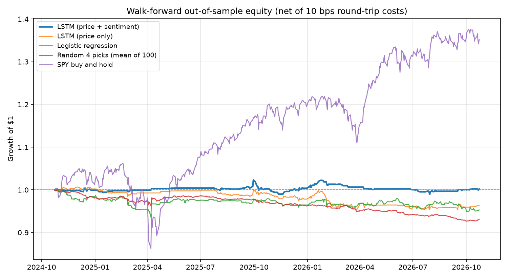

# stockbot

A daily S&P 500 direction model: a 2-layer LSTM over 20 sessions of price features and
Finnhub headline sentiment (VADER), validated with a leakage-checked walk-forward backtest
against logistic, random, and SPY baselines, and executed on the **Alpaca paper** API.

> Results below are produced by `stockbot backtest` and reported as-is, including
> confidence intervals. No numbers in this README were tuned toward a target.

## Results

<!-- RESULTS:START -->
Walk-forward out-of-sample test, **2024-10-24 to 2026-10-23** (501 sessions, 8 folds,
100 tickers), net of 10 bps round-trip costs. Seed 42.

| Model | Accuracy (95% CI) | Hit rate | Mean net return / trade (95% CI) | Sharpe | Max DD | Total return | Trades | Trades/day |
|---|---|---|---|---|---|---|---|---|
| LSTM (price + sentiment) | 50.5% [50.1%, 51.0%] | 48.6% | 0.011% [-0.193%, 0.215%] | 0.05 | -3.29% | 0.20% | 484 | 0.97 |
| LSTM (price only) | 50.5% [50.1%, 51.0%] | 46.8% | -0.086% [-0.242%, 0.072%] | -0.57 | -5.30% | -3.74% | 864 | 1.72 |
| Logistic regression | 50.4% [50.0%, 50.9%] | 46.3% | -0.100% [-0.299%, 0.094%] | -0.48 | -6.40% | -4.69% | 913 | 1.82 |
| Random 4 picks (mean of 100) | n/a | 47.8% | -0.072% | -1.03 | -8.35% | -6.98% | 2004 | 4.00 |
| SPY buy and hold | n/a | n/a | n/a | 1.03 | -18.74% | 35.17% | n/a | n/a |



**What this shows**

- **No detectable edge.** 50.8% of out-of-sample sessions closed above their open, so the
  LSTM's 50.5% accuracy (CI 50.1% to 51.0%) is no better than always guessing "up".
- **Flat after costs.** The LSTM made +0.20% over two years. Its mean return per trade
  (+0.011%) has a 95% interval that spans zero. SPY returned +35% over the same period.
- **Selectivity limited losses.** The 0.55 confidence threshold cut the LSTM to about one
  trade a day, and it lost less than the logistic baseline (-4.7%), the price-only LSTM
  (-3.7%), and random picks (-7.0%). These gaps sit inside the confidence intervals.
- **Sentiment ablation is inconclusive.** Adding headline sentiment moved mean return from
  -0.086% to +0.011% per trade, but the intervals overlap. With one year of news, most
  training windows contain no headlines.
- The final model's validation loss is 0.6931 (= ln 2), meaning it learned roughly the base
  rate. On 2026-10-26 no ticker cleared the 0.55 threshold (top: MRK at 0.52), so the bot
  placed no orders.

Daily open-to-close direction for large caps is close to a coin flip. This pipeline is built
to measure that honestly: walk-forward folds, an embargo, train-only normalization, and
automated look-ahead checks.
<!-- RESULTS:END -->

## How it works

```
Finnhub news --> ingest-news --> news (+VADER) ----\
                                                    +--> features --> train / backtest
Alpaca bars  --> ingest-prices --> bars_daily -----/          |
                                                       models + artifacts
                                                              |
                                  signal (p_up, rank, top 4) --> signals
                                                              |
             trade (opg buys) --> exit (cls sells) --> reconcile    (Alpaca PAPER only)
```

| Stage | What it does |
|---|---|
| Data | ~100 large-cap S&P 500 names, 5 years of adjusted daily bars (IEX feed), 1 year of headlines |
| Features | 8 price features (1/5/20-day log returns, 20-day volatility, volume z-score, range, gap, open-to-close) + 5 sentiment features (mean/max/min VADER, headline count, has-news flag) |
| Label | `1` if the **next** session's close is above its open |
| Model | One global LSTM (2 x 64, dropout 0.2) on `(batch, 20, 13)` windows, AdamW, early stopping |
| Validation | 8 consecutive 3-month out-of-sample blocks over the last 24 months; each trains only on earlier data with a 5-session embargo |
| Strategy | Each day buy the top 4 tickers with `p_up >= 0.55` at the open, sell at the close, 5% of equity each, 5 bps cost per side |

### Guarding against look-ahead

- `leakcheck.assert_no_future_dependence` recomputes features after deleting all data after
  `t` and requires identical values (to 1e-9). `train` and `backtest` refuse to run otherwise.
- `leakcheck.assert_no_target_proxy` fails if any feature equals the label or has |corr| > 0.5
  with the next-session return.
- Normalization statistics come from each fold's training slice only.
- Headlines published after the 16:00 ET close count toward the **next** session.

### Safety

- Every Alpaca client is built through `broker.py`, which refuses to start unless
  `ALPACA_PAPER=true` and the base URL is `https://paper-api.alpaca.markets` (exit code 3).
- The only sell path re-checks the live position; the bot cannot open a short.
- Orders use deterministic `client_order_id`s (`{date}-{symbol}-{side}`), so re-running
  `trade` or `exit` never duplicates an order.
- Secrets are redacted from logs, error output, and the `runs` table.

## Quickstart

```bash
uv sync
cp .env.example .env            # add Alpaca paper + Finnhub keys
uv run stockbot init-db
uv run stockbot load-universe
uv run stockbot ingest-prices   # ~1 min
uv run stockbot ingest-news     # first run ~25 min (Finnhub free tier: 50 req/min)
uv run stockbot features
uv run stockbot backtest        # writes reports/backtest-*.md|json|png
uv run stockbot train
uv run stockbot signal
uv run stockbot trade --dry-run
```

Daily schedule (America/New_York): `nightly` at 17:00, `trade` at 08:45, `exit` at 15:45,
`reconcile` at 16:20.

## Development

```bash
uv run pytest
uv run ruff check . && uv run ruff format --check .
```

Tests use fixtures and fake clients only; they never call Alpaca or Finnhub.

## Limitations

- **Survivorship bias:** today's large-cap constituents are applied to five years of history.
- **Short sentiment history:** Finnhub's free tier returned exactly one year of headlines
  (about 2,150 per ticker), so most training windows have no news and the sentiment ablation
  has limited power.
- **Universe:** a hand-built list of about 100 of the largest S&P 500 names (`data/sp500.csv`).
- **Fill model:** the backtest assumes official open and close prices plus a flat cost.
- **Exposure:** at most 4 x 5% = 20% of equity is invested on any day, so absolute returns are
  not directly comparable with a fully invested SPY position.

Specification: [`docs/PRD-lstm-stock-bot.md`](docs/PRD-lstm-stock-bot.md).
